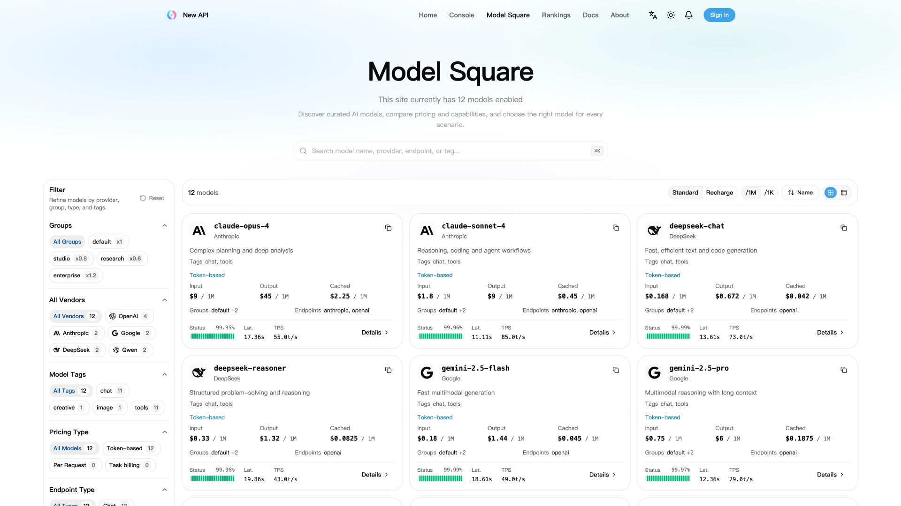

# New API

🍥 **Next-Generation LLM Gateway and AI Asset Management System**

**Secondary-Development Fork** — based on [New API by QuantumNous](https://github.com/QuantumNous/new-api)

  <!--
  -->
  
  
  
  

  
   
  
  

  <a href="#screenshots">Screenshots</a> •
  <a href="#fork">Fork features</a> •
  <a href="https://docs.newapi.pro/en/docs">Documentation</a>

## 📝 Project Description

> [!IMPORTANT]
> - This project is intended solely for lawful and authorized AI API gateway, organization-level authentication, multi-model management, usage analytics, cost accounting, and private deployment scenarios.
> - Users must lawfully obtain upstream API keys, accounts, model services, and interface permissions, and must comply with upstream terms of service and applicable laws and regulations.
> - Users should ensure their use complies with upstream terms of service and applicable laws and regulations.
> - When providing generative AI services to the public, users should comply with applicable regulatory requirements and fulfill all filing, licensing, content safety, real-name verification, log retention, tax, and upstream authorization obligations required by their jurisdiction.

---

## Screenshots

Accounts, channels, plugin installation states, usage, prices, and costs shown below are simulated data. The marketplace displays the official plugin catalog. Click an image to view it at full size.

| Usage dashboard | Plugin marketplace |
| --- | --- |
|  |  |
| **Model square** | **Usage logs** |
|  |  |

---

## 🤝 Trusted Partners

  
  
  
  

---

## 🔀 About This Fork

This repository is a secondary-development fork of [QuantumNous/new-api](https://github.com/QuantumNous/new-api) (upstream). It tracks upstream `main` and documents only the features and fixes added by this fork. For complete upstream documentation, see [docs.newapi.pro](https://docs.newapi.pro/en/docs).

### 📌 Situation

- The upstream wallet quota contract uses a single per-top-up limit (`MaxQuota`, capped at `math.MaxInt32`). With a high `QuotaPerUnit` value such as `500000`, repeated top-ups, redemptions, and admin adjustments can exceed the per-operation int32 boundary.
- The payable amount can then silently become `0`, while payment, redemption, and admin-credit paths lack one shared aggregate wallet ceiling.

### 🎯 Task

- Keep recharge amounts correct at high `QuotaPerUnit` values without breaking existing Epay or Stripe flows.
- Add a hard aggregate wallet ceiling that every credit path enforces and that fails closed on overflow, across SQLite, MySQL, and PostgreSQL.

### 🛠️ Action

- Keep the int32 per-top-up limit (`MaxQuota`) and add the int64 aggregate ceiling `MaxWalletQuota` ($2,000,000 equivalent), with shared quota conversion helpers in `common/quota_math.go`.
- Protect payment settlement with atomic conditional updates; redemption codes and admin `add_quota` operations check wallet headroom and fail closed instead of wrapping.
- Scope Epay price and minimum top-up settings to the Epay settings tab.
- Add fork infrastructure: one-click self-update with release checksum verification and atomic replacement, Docker pull-and-recreate, Compose image synchronization, root-only update APIs and UI, server-authoritative registration invite modes, minimum GitHub account age for OAuth, and exact-tag release CI.

### 📈 Result

- Recharge amounts remain correct at `QuotaPerUnit=500000`; no credit can exceed `MaxWalletQuota`.
- Credit paths are overflow-safe and race-safe, including single-success concurrent redemption and atomic payment settlement.
- Released as [`v1.0.0-rc.25-th.13`](https://github.com/ChinaToyHunter/new-api/releases/tag/v1.0.0-rc.25-th.13) (merge commit `ea0ba918`).

### 🆚 Quick Comparison

| Area | Upstream (QuantumNous/new-api) | This Fork |
|---|---|---|
| Wallet capacity | Per-top-up int32 limit only | Per-top-up int32 + int64 aggregate ceiling ($2,000,000) |
| High-`QuotaPerUnit` overflow | Payable amount can silently become 0 | Correct amount calculation with fail-closed guards |
| Redemption / admin credit | No shared aggregate ceiling | Atomic wallet-headroom checks |
| Epay settings | Generic placement | Scoped to the Epay settings tab |
| Self-update | Manual upgrade | Checksum-verified one-click update, Docker recreate, Compose sync |
| Registration invites | Single global toggle | Optional / required / hidden modes |
| Release versioning | Upstream tags | `v{upstream}-th.{x}` fork release line |

### 🏷️ Fork Releases

The fork publishes `v{upstream}-th.{x}` releases on the [Releases page](https://github.com/ChinaToyHunter/new-api/releases). Current release: [`v1.0.0-rc.25-th.13`](https://github.com/ChinaToyHunter/new-api/releases/tag/v1.0.0-rc.25-th.13).

---

## 📜 License

This project is licensed under the [GNU Affero General Public License v3.0 (AGPLv3)](./LICENSE).

Additional terms under AGPLv3 Section 7 apply. Modified versions must preserve
the author attribution notice `Frontend design and development by New API
contributors.` in the appropriate legal notices and in any prominent about,
legal, footer, or attribution location presented by the user interface.

Modified versions that present a user interface must also preserve a visible
link to the original project: <https://github.com/QuantumNous/new-api>.

This is an open-source project developed based on [One API](https://github.com/songquanpeng/one-api) (MIT License).

If your organization's policies do not permit the use of AGPLv3-licensed software, or if you wish to avoid the open-source obligations of AGPLv3, please contact us at: [support@quantumnous.com](mailto:support@quantumnous.com)

---

## 🌟 Star History

If you find this fork useful, please consider starring ⭐️ [ChinaToyHunter/new-api](https://github.com/ChinaToyHunter/new-api) — and if you use upstream directly, star [QuantumNous/new-api](https://github.com/QuantumNous/new-api) too.

---

### 💖 Thank you for using New API

Built with ❤️ by QuantumNous

Fork maintained by <a href="https://github.com/ChinaToyHunter">ChinaToyHunter</a>

